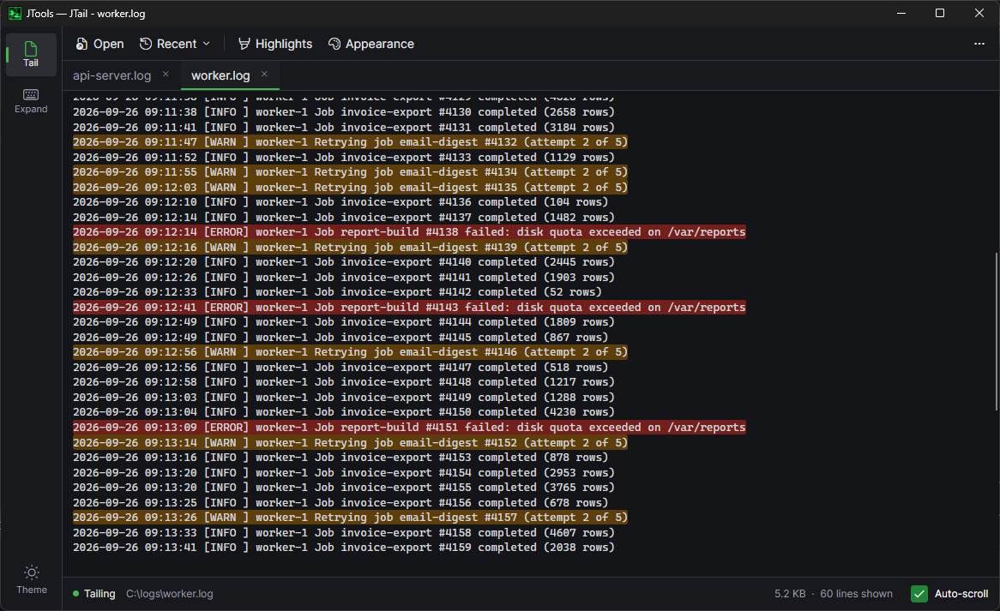
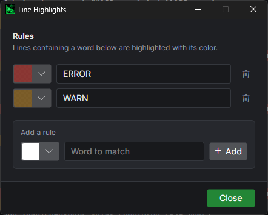
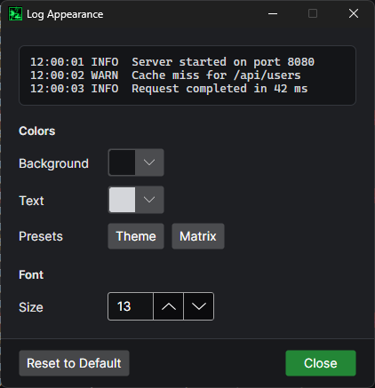
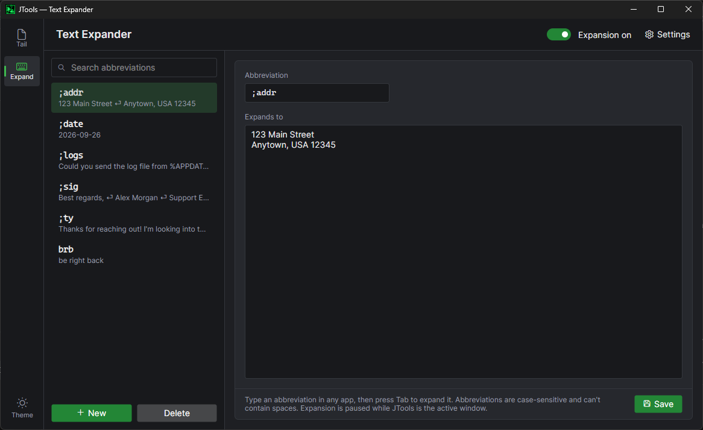
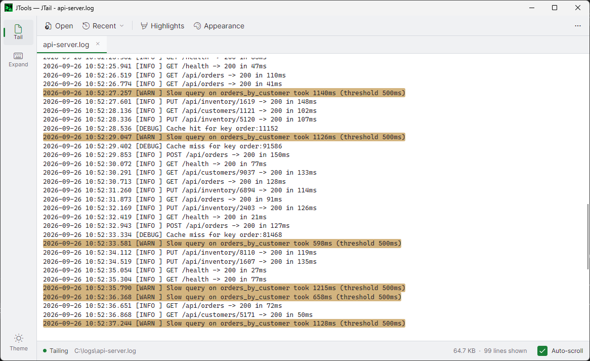

# JTools

A small Windows tray app that puts three everyday tools in one window:

- **Tail**: a live log viewer. Open several log files in tabs, watch new lines as they're written, and highlight lines that contain words like `ERROR` or `WARN`.
- **Expand**: a text expander. Type an abbreviation such as `;sig` in any app and it expands into the full text.
- **Regex**: a regular expression tester. Write a .NET regex and see its matches and capture groups in your sample text as you type.



## Download

Get **JTools.exe** from the [latest release](https://github.com/LegoLife/JTools/releases/latest). It's a single self-contained file for 64-bit Windows 10/11, so there's nothing else to install. Just run it.

Windows SmartScreen may warn you the first time because the exe isn't code-signed. Choose **More info** → **Run anyway**.

## Tail

- Open log files with **Open**, **Recent**, or by dragging them onto the window. Each file gets its own tab.
- New lines appear as they're written. **Auto-scroll** follows the end of the file.
- **Find** (Ctrl+F) highlights text in the log. Enter or F3 goes to the next match, Shift+Enter or Shift+F3 to the previous one.
- **Filter** (Ctrl+Shift+F) shows only the lines that contain some text, including new lines as they arrive, and says how many lines it hides.
- Find and filter can match case (**Aa**) or use a .NET regular expression (**.\***). Each tab keeps its own.
- **Highlights** colors every line that contains a chosen word.
- **Appearance** sets the log colors and font size. Use the theme's colors, the green-on-black **Matrix** preset, or your own.

| Line highlights | Log appearance |
| --- | --- |
|  |  |

## Expand

- Create abbreviations that expand into any text, including multiple lines.
- Expansions can contain placeholders:

  | Placeholder | Becomes |
  | --- | --- |
  | `{date}`, `{time}` | Today's date or the current time, in your Windows format |
  | `{date:yyyy-MM-dd}`, `{time:HH:mm}` | The same, in a [.NET format](https://learn.microsoft.com/dotnet/standard/base-types/custom-date-and-time-format-strings) of your choice |
  | `{clipboard}` | The text on the clipboard |
  | `{cursor}` | Where the caret ends up after expanding (the trigger key isn't typed) |
  | `{input:name}` | A fill-in. Expansion stops here with `name` selected; type a value and press Tab or Enter to continue, or Esc to stop. Later `{input:name}`s in the same expansion repeat the value. A bare `{input}` asks every time |
  | `{{` | A literal `{` |
- Test your abbreviations in the **Try it** box under the editor. Expansion is otherwise paused while JTools is the active window.
- Choose whether to expand immediately or when you press Space, Tab and/or Enter (**Settings**).
- Turn expansion on or off with the switch at the top.



## Regex

- Type a pattern and some test text. Matches are highlighted as you type, in alternating shades so neighboring matches stay distinct.
- The table has a row per match: its index, position and matched string, then a column per capture group, headed the way a replacement refers to it (`$1`, `${year}`). Groups that didn't take part in a match show `—`.
- Click a cell to outline that match or group in the text; click inside a match in the text to jump to its row.
- Option toggles: `i` ignore case, `m` multiline, `s` singleline, `x` ignore pattern whitespace (Enter adds a new line), `n` explicit capture.
- Invalid patterns show the error and underline where it went wrong. Runs stop after 3 seconds, so a runaway pattern can't freeze the app.
- **Copy as C#** copies `new Regex(@"...", RegexOptions...)`. Right-click the table to copy a cell or the whole table as TSV.
- Your last pattern, test text and options are remembered.
- **Save As…** keeps the pattern, its test text and options under a name. Pick a saved regex from the list to load it. A dot beside the list means you've changed it since; **Save** updates it, and **Delete** removes it from the list.

## Side bar, themes and tray

- **Tools** at the bottom of the side bar turns each tool on or off. A tool that's off is hidden and stops running: Tail closes its files, and Expand stops watching the keyboard. One tool always stays on.
- JTools opens on the tool you used last.
- **Data** at the bottom of the side bar exports everything JTools keeps (abbreviations, Expand settings, saved regexes, Tail highlights and log appearance, and app settings) to one JSON file, and imports it on another PC. Tail's recent files aren't included. Importing replaces your current data: JTools backs it up first to `%APPDATA%\JToolsackups`, then restarts to load the imported data.
- **Data** → **Back up every 15 minutes** saves the same file to a folder you choose (OneDrive, say), and once more when JTools exits, but only when something changed. The newest 3 backups are kept, and the Data menu shows when the last one was made. Import a backup to restore it. Where this PC backs up to isn't part of the backup.
- Dark, Light, or match your Windows setting (**Theme** at the bottom of the side bar).
- JTools runs from the system tray. Closing the window only hides it, so text expansion keeps working. Quit from the tray menu.
- Press **Ctrl+Alt+J** in any app to show JTools, or to hide it when it's already in front. If another app already uses that shortcut, the tray menu says so.
- Optionally **Start with Windows** (tray menu). It starts hidden in the tray.



## Notes

- Only one app can expand text at a time. If the standalone Text Expander is running, exit it first, or turn Expand off in JTools.
- Text can't be expanded in apps running as administrator unless JTools also runs as administrator (a Windows security rule).

## Building

Requires the .NET 10 SDK.

```
dotnet run --project JTools
dotnet test JTools.Tests
dotnet publish JTools/JTools.csproj -c Release -o publish
```

The publish command produces a single self-contained `publish/JTools.exe` for win-x64.
